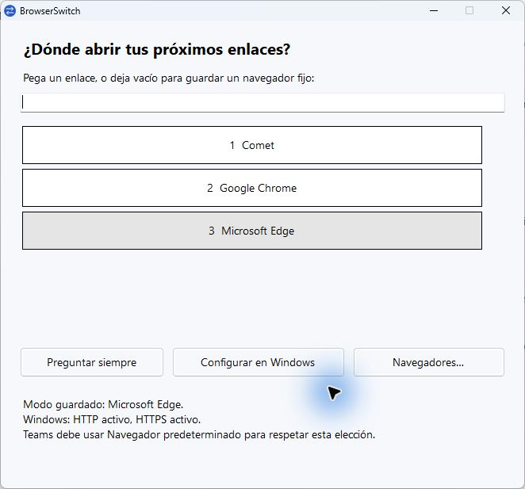
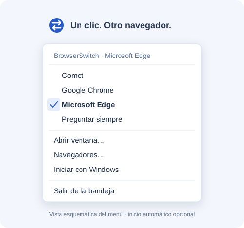
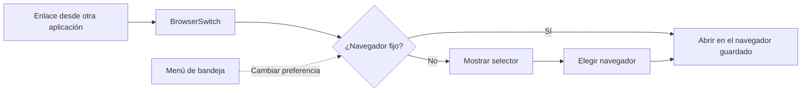

<p align="center">
  
</p>
<h1 align="center">BrowserSwitch</h1>
<p align="center"><strong>Tus enlaces, tu navegador.</strong><br>Elige dónde abrir cada enlace o cambia de navegador desde la bandeja de Windows.</p>
<p align="center">
  
  
  
  <a href="docs/VALIDATION.md"></a>
</p>
<p align="center">
  <a href="#-empezar">Empezar</a> · <a href="#-cómo-se-usa">Uso</a> · <a href="docs/WINDOWS.md">Guía de Windows</a> · <a href="docs/VALIDATION.md">Validación</a> · <a href="src/BrowserSwitch/Assets/BrowserSwitch.ico">Icono ICO</a>
</p>

---

## 👀 Así se ve

<table>
  <tr><th>Selector completo · captura real</th><th>Cambio rápido · esquema de la bandeja</th></tr>
  <tr>
    <td width="50%"></td>
    <td width="50%"></td>
  </tr>
</table>

La lista se adapta a los navegadores detectados en tu equipo. Puedes agregar otros y personalizar sus argumentos.

## ✨ Qué puedes hacer

| 🔀 Elegir en cada enlace | 📌 Recordar un navegador | 🖱 Cambiar desde la bandeja |
| --- | --- | --- |
| Activa **Preguntar siempre** y decide dónde abrirlo. | Guarda una elección para los siguientes enlaces. | Haz clic en el icono azul y elige otro navegador. |

| Además | Cómo funciona |
| --- | --- |
| 🔎 Detección automática | Consulta navegadores registrados por usuario y por equipo; evita duplicados. |
| 🛠 Entradas manuales | Agrega, edita u oculta navegadores y configura argumentos para perfiles. |
| 👤 Instalación por usuario | Se prepara en tu carpeta local, sin solicitar administrador. |
| 🔗 HTTP, HTTPS y HTML | Conserva el manejo de enlaces y archivos `.htm` / `.html`. |
| 🌙 Residente sin sondeos | Una sola instancia de bandeja, sin temporizadores ni conexiones de red en reposo. |
| 🔒 Preferencias personales | Se guardan fuera del repositorio. No registra enlaces, historial ni cuentas. |

## 🚀 Empezar

**Requisitos:** Windows 10/11 con **.NET Framework 4.8** instalado y una consola PowerShell para Windows permitida en tu equipo. No hace falta Visual Studio, un SDK moderno ni paquetes NuGet.

### 1 · Compilar y preparar

Desde la raíz del repositorio, en una consola normal de Windows:

```powershell
.\scripts\Build.ps1
.\scripts\Test.ps1
.\scripts\Install.ps1 -OpenSettings
```

**Alternativa gráfica:** después de compilar, abre `artifacts\windows\BrowserSwitch.exe` desde el Explorador y pulsa **Instalar BrowserSwitch**.

> El repositorio puede estar en WSL; el programa que ejecuta Windows debe quedar en una carpeta local. Si tu consola está empaquetada o PowerShell está bloqueado por la organización, consulta la [guía de rutas e instalación](docs/WINDOWS.md#rutas-código-y-programa-instalado). No se cambian políticas del equipo.

### 2 · Elegirlo en Windows

En **Configuración → Aplicaciones → Aplicaciones predeterminadas → BrowserSwitch**, asigna **HTTP** y **HTTPS**. Puedes asignar también `.htm` y `.html`.

BrowserSwitch conserva el identificador técnico `SelectorNavegadorPersonal` para mantener asociaciones existentes. La selección se hace con la interfaz normal de Windows; el programa no fuerza `UserChoice` ni sus hashes.

### 3 · Abrir un enlace

Abre un enlace desde otra aplicación. Elige un navegador o marca **Usar esta elección para los próximos enlaces**. El icono azul queda disponible en la bandeja para cambiar rápidamente.

## 🖱 Cómo se usa

| Quiero… | Acción |
| --- | --- |
| Cambiar el navegador fijo | Clic en el icono de bandeja → nombre del navegador. La marca indica el activo. |
| Elegir cada vez | Bandeja → **Preguntar siempre**. |
| Pegar un enlace | Bandeja → **Abrir ventana…** → pega una dirección completa y elige navegador. |
| Agregar o editar navegadores | Bandeja → **Navegadores…** → realiza cambios → **Guardar**. |
| Iniciarlo al entrar a Windows | Activa **Iniciar con Windows**. Es opcional y viene desactivado. |
| Cerrar el residente | **Salir de la bandeja**. Windows puede seguir abriendo enlaces mediante instancias breves. |

Si el icono está oculto, búscalo dentro de **^** junto al reloj y arrástralo a la zona visible. Cerrar la ventana completa conserva el residente; abrir el acceso directo otra vez reutiliza la misma instancia.

### El recorrido de un enlace



> **Microsoft Teams:** en sus opciones de enlaces elige **Navegador predeterminado**. Si Teams está configurado para abrir directamente en Edge, puede omitir BrowserSwitch. [Ver detalle](docs/WINDOWS.md#microsoft-teams).

## 📂 Dónde queda todo

```text
Repositorio                         Instalación de Windows
src/                                %LOCALAPPDATA%\BrowserSwitch\
scripts/                            ├── BrowserSwitch.exe
docs/                               ├── BrowserSwitch.exe.config
                                    ├── BrowserSwitch.ico
                                    └── Data\settings.xml
```

El código y la copia instalada están separados. Los binarios generados, accesos directos, diagnósticos y preferencias personales no se suben a Git.

## 🔄 Actualizar o desinstalar

| Actualizar | Desinstalar |
| --- | --- |
| Usa **Salir de la bandeja**, actualiza el código y repite `Install.ps1`. Se conservan tus preferencias y el destino local. | Primero elige otro navegador en Windows; después ejecuta `Uninstall.ps1`. Los datos personales se conservan por defecto. |
| [Actualización y recuperación](docs/WINDOWS.md#actualizar) | [Desinstalación y limpieza opcional](docs/WINDOWS.md#desinstalar) |

## 🧩 Proyecto y plataformas

```text
src/BrowserSwitch.Core/    Modelos y validación de enlaces
src/BrowserSwitch/         WinForms e integración Windows
scripts/                  Compilación, preparación, pruebas e iconos
docs/                     Guías, imágenes y resultados de validación
tests/                    Pruebas sin dependencias externas
```

- [x] **Windows:** implementado y validado localmente; [resultados y límites](docs/VALIDATION.md).
- [ ] **macOS:** futuro, con integración nativa propia.
- [ ] **Linux:** futuro, con integración nativa propia.

La lógica compartible está separada de WinForms y del registro. BrowserSwitch es independiente de Browser Picker: se consultó su código público como referencia para el registro por usuario, sin depender de sus ejecutables ni bibliotecas.

### Recursos gráficos

<p><a href="docs/assets/browserswitch.png"></a></p>

[PNG · 256 px](docs/assets/browserswitch.png) · [ICO · 16 a 256 px](src/BrowserSwitch/Assets/BrowserSwitch.ico) · [Generador del icono](scripts/Generate-Icon.ps1)

El mismo diseño se utiliza en el ejecutable, la bandeja y los accesos directos. Para regenerar los recursos, ejecuta `scripts/Generate-Icon.ps1`.